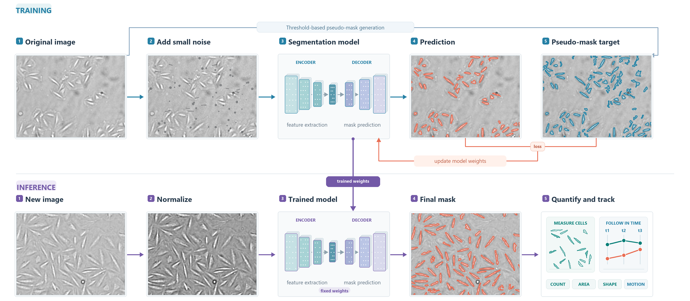

# smc-pipeline

Bright-field nuclear segmentation and frame-to-frame tracking for time-lapse imaging of
vascular smooth muscle cells (VSMCs). Code accompanying the SMC manuscript.



## Pipeline

1. **Segment** (`smc-pipeline segment`): bright-field TIFFs are normalised (ImageNet mean/std),
   passed through the segmentation network, thresholded (default 0.5), and connected components
   smaller than 80 px are removed. One JSON per image stores, for every detected nucleus, its
   centroid, area, bounding box, eccentricity, equivalent diameter, perimeter, solidity,
   roundness (4πA/P²) and outline.
2. **Track** (`smc-pipeline track`): nuclei are linked across frames of one well/field and
   written to a tidy CSV (`track_id, frame, x, y, area, eccentricity, perimeter, roundness`).

### Tracking details

For each active track, candidates in the next frame within a search radius of the last known
centroid (default **16 px**, i.e. 4 × magnification at 4×) are scored; the lowest score among
unclaimed candidates is linked (greedy, tracks processed in creation order). Unmatched
detections start new tracks; a track ends after **2** consecutive missed frames.

```
score = 0.3·d_centroid + 1.0·d_area + 1.0·d_Hu + 0.3·d_ecc + 0.3·d_perimeter + 0.3·d_roundness
```

`d_centroid` is Euclidean distance in pixels; `d_area` and `d_perimeter` are differences
relative to the previous detection; `d_Hu` is the Euclidean distance between the 7-element
Hu-moment vectors of the outlines; `d_ecc` and `d_roundness` are absolute differences.
Features are not normalised. There is no explicit handling of division, death, field
entry/exit, merges or splits: such events appear as track ends and new track starts. No
minimum track length is applied; filter the CSV downstream. All parameters live in
`TrackerConfig` (`src/smc_pipeline/tracking.py`).

## Install

```bash
pip install -e .            # tracking only
pip install -e ".[segment]" # adds PyTorch for segmentation
```

## Usage

```bash
smc-pipeline segment --input path/to/tifs --output out/json --weights model.pth
smc-pipeline track --json-dir out/json --prefix "A1_03_1_24_Bright Field-High Contrast" \
                   --output out/A1_tracks.csv
```

Per-frame JSON files must be named `<prefix>_<frame>.json` (e.g. `…_001.json`), which is how
the segmentation step names them when images are exported as `<prefix>_<frame>.tif`.
Pixel size and frame interval are not applied by the code; convert pixel units to µm using
your acquisition metadata.

## Notes

- **Model weights and data are not included.** The network is defined in
  `src/smc_pipeline/model.py`: a strided convolutional encoder and a small convolutional
  decoder. Checkpoints trained with the original research code (class names
  `DummySAMEncoder` / `SAMSegmentationModel`) load unchanged because layer names are identical.
- Training pseudo-masks (Otsu + adaptive thresholding) are not part of this release.

## Tests

```bash
pip install -e ".[dev]" && pytest
```

## License

MIT
